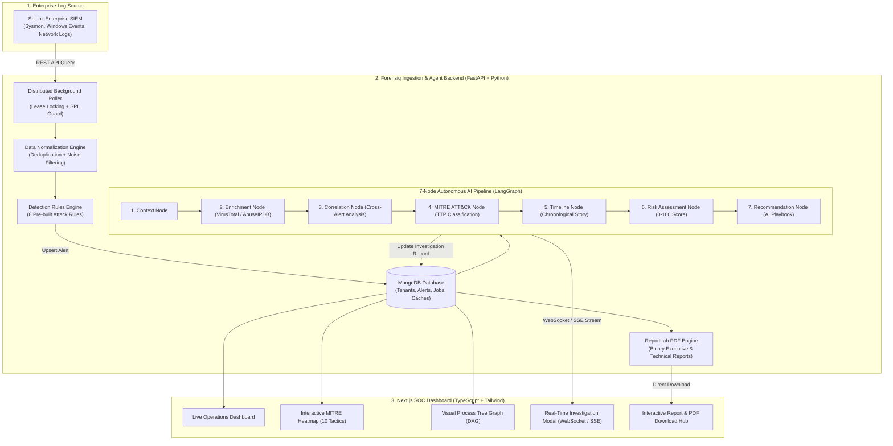

# Chapter 1: High-Level Overview & Core Concepts

If you have **zero knowledge of cybersecurity**, this document is your starting point. It explains what problem Forensiq solves, why it exists, and the basic ideas behind everything you see on screen.

---

## 1. What is Forensiq in Plain English?

Think of a bank or a hospital. They have hundreds of computers, servers, and cloud accounts. Every second, those computers generate "activity logs":
- *"User Alice logged into laptop at 9:02 AM"*
- *"Computer X opened a website at 9:03 AM"*
- *"PowerShell script was executed on Server 5 at 9:04 AM"*

Every single day, an enterprise generates **tens of millions of these logs**. 

Somewhere inside those millions of logs, an attacker (hacker) might have just broken in and executed a malicious command to steal customer credit cards.

### The Problem Today
1. **Human Fatigue (Alert Fatigue)**: Human security analysts (called SOC analysts) have to sit in front of monitors looking at alerts. They receive thousands of alerts every day. 95% of them are false alarms or harmless noise.
2. **Slow Response**: Investigating a single alert by hand takes a human analyst 20 to 45 minutes: they must copy IP addresses, check them on external reputation databases, trace what process spawned what program, look up the attacker's tactics on MITRE ATT&CK, and write a Word or PDF report.
3. **The Result**: Real breaches sit undetected for months because humans can't keep up.

### How Forensiq Solves This
**Forensiq is an Autonomous AI Security Analyst.**
- It continuously listens to the incoming stream of security logs from enterprise engines (like **Splunk**).
- It immediately detects suspicious patterns using specialized detection rules.
- Instead of waiting for a tired human, **it launches a team of 7 autonomous AI agents** (using LangGraph and Gemini LLM) that work in parallel.
- The AI extracts the attacker's IPs/hashes, asks global threat intelligence databases (VirusTotal, AbuseIPDB) if they are known malware, correlates related events across the company, maps the adversary's playbook, calculates a mathematical risk score (0–100), and creates remediation recommendations.
- It displays this in an interactive dashboard with **MITRE ATT&CK Threat Heatmaps** and an **Attack Flow Execution Tree Graph**.
- Finally, it can generate a branded, **one-click publication-ready PDF report** ready to hand to a Chief Information Security Officer (CISO).

---

## 2. Core Cybersecurity Concepts Explained Simply

To understand Forensiq, you only need to know 6 basic terms:

### 1. What is a SIEM (Security Information & Event Management)?
- **Analogy**: A giant digital security camera system and DVR that collects logs from every computer in an organization into one central place.
- **Example in Forensiq**: **Splunk Enterprise**. Splunk collects logs from Windows, Linux, firewalls, and Active Directory. Forensiq connects to Splunk via its REST API to read these logs.

### 2. What is an Alert?
- When a log matches a dangerous rule (for example: *"A user failed their password 100 times in 10 seconds"* or *"PowerShell was launched with hidden encoded commands"*), the system flags it as an **Alert**.
- An alert has a **Severity**: `Critical` (immediate danger), `High`, `Medium`, or `Low`.
- An alert has a **Status**: `New` &rarr; `Investigating` &rarr; `Investigated` &rarr; `Closed`.

### 3. What is an IOC (Indicator of Compromise)?
- **Analogy**: Fingerprints or DNA left behind at a crime scene.
- In cyber, an IOC is any digital artifact left behind by an attacker:
  - **Malicious IP Address**: e.g., `194.26.29.112` (the hacker's server).
  - **Malicious Domain**: e.g., `update-c2.cloud` (the fake website malware talks to).
  - **File Hash**: A unique digital fingerprint of a file (e.g., SHA256 string like `e3b0c44298fc1c149...`). If that hash matches known ransomware, the file is dangerous.

### 4. What is "Defanging"?
- If you copy-paste a dangerous web link like `http://malware.ru/virus.exe` in an email or Slack, someone might accidentally click it, or an automated email scanner might block your message.
- **Defanging** alters the text so it cannot be clicked as a live link:
  - `http://malware.ru` becomes `hxxp[://]malware[.]ru`
  - `194.26.29.112` becomes `194.26.29[.]112`
- Forensiq includes automated defanging in its UI so analysts can safely inspect and copy IOCs without risk.

### 5. What is MITRE ATT&CK?
- **Analogy**: The FBI's behavioral encyclopedia of criminal tactics.
- Created by the MITRE Corporation, it catalogs every known method hackers use into:
  - **Tactics** (Goals, e.g., *Credential Access*, *Lateral Movement*).
  - **Techniques** (Actions, e.g., `T1059.001` *PowerShell Scripting*, `T1003` *OS Credential Dumping*).
- Forensiq categorizes every alert against the official MITRE ATT&CK Enterprise Matrix.

### 6. What is a Process Tree (Lineage)?
- On Windows or Linux, programs don't just appear out of nowhere. One program starts another program.
- **Example**:
  - `explorer.exe` (Windows desktop) &rarr; starts `cmd.exe` (Command prompt) &rarr; starts `powershell.exe` &rarr; connects to an external IP &rarr; writes `payload.bin`.
- Forensiq builds an SVG visual graph called the **Visual Process Execution Tree** so analysts can see the exact parent-child hierarchy of how malware was launched.

---

## 3. High-Level System Architecture Diagram

---

## 4. Key Takeaways for Presenting Forensiq

When describing Forensiq to colleagues, managers, or interviewers, remember these three main pillars:

1. **Automation Over Manual Drudgery**: Instead of 45 minutes of manual lookups per alert, Forensiq's AI investigates in **under 10 seconds**.
2. **Actionable Visual Context**: It doesn't just show text; it draws the **Process Execution DAG Tree** and highlights observed TTPs on the **MITRE Heatmap**.
3. **Enterprise Ready**: Full MongoDB multi-tenancy, live Splunk REST ingestion, distributed lease locking, WebSocket streaming, and server-side binary PDF generation.

---

*Next Chapter: [Chapter 2: Architecture & End-to-End Data Flow](file:///d:/Forensiq/docs/project_handbook/02_architecture_and_end_to_end_data_flow.md)*
