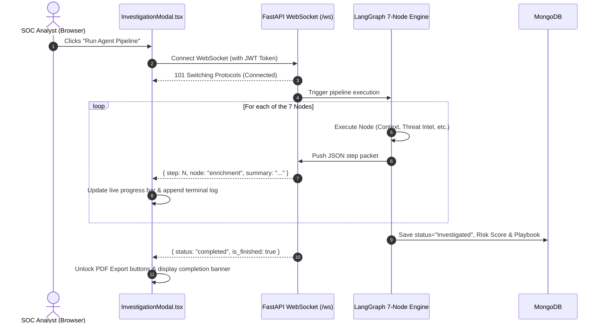

# Chapter 6: Frontend UI, Visualizations & WebSockets

The **Forensiq Frontend** is an ultra-modern, responsive Next.js 14 application built for Security Operations Center (SOC) analysts. It adheres strictly to modern minimalist design tokens, supporting **true Black mode** (`#000000` / `#0A0A0A`) and **clean White mode** (`#FFFFFF` / `#FAFAFA`).

This chapter explains the main pages, what each visualization represents, and how real-time WebSockets keep the UI synchronized.

---

## 1. Overview of Key Frontend Pages

| Route | Page File | Purpose & Capabilities |
|---|---|---|
| `/` | `src/app/page.tsx` | **SOC Operations Dashboard**: High-level KPIs (Critical Alerts, Active Investigations, AI Confidence), 24-hour alert activity bar chart, pending triage queue, and the interactive **MITRE ATT&CK Matrix & Heatmap**. |
| `/alerts` | `src/app/alerts/page.tsx` | **Alerts Queue**: Filterable table of all ingested alerts by severity, status, host, and rule name. 1-click status transitions (`New` &rarr; `Investigated` &rarr; `Closed`). |
| `/investigations` | `src/app/investigations/page.tsx` | **Investigation Workspace**: Two-column analyst workbench. Left: case selector. Right: 7-stage LangGraph pipeline visualizer, the **Visual Process Execution Tree**, chronological timeline, AI Playbook, and PDF download buttons. |
| `/reports` | `src/app/reports/page.tsx` | **Report Management Hub**: Dedicated document portal to preview case details, download binary Executive PDFs (1-page) and Full Technical Reports, or export Markdown bundles. |
| `/search` | `src/app/search/page.tsx` | **Splunk SPL Query Console**: Direct search interface to query raw security telemetry from Splunk with built-in SPL guardrails and syntax validation. |

---

## 2. Interactive Feature: MITRE ATT&CK Matrix & Heatmap

Located on the main dashboard ([`src/components/mitre/MitreMatrix.tsx`](file:///d:/Forensiq/frontend/src/components/mitre/MitreMatrix.tsx)), this component visualizes adversary techniques across the entire organization.

```
+-----------------------------------------------------------------------------------------------+
| MITRE ATT&CK MATRIX & HEATMAP   [Enterprise v14]   Active TTPs: 6  •  Hits: 112   [Filter...]  |
+-----------------------------------------------------------------------------------------------+
| Intensity: (🔴 High 20+)  (🟠 Medium 5-19)  (🔵 Active 1-4)  (⚫ Covered 0)                   |
+------------+------------+------------+------------+------------+------------+-----------------+
| InitAccess | Execution  | Persist    | PrivEsc    | DefEvasion | CredAccess | LateralMove ... |
+------------+------------+------------+------------+------------+------------+-----------------+
| T1190      | T1059.001  | T1547.001  | T1068      | T1027      | T1003      | T1021.001       |
| Exploit App| PowerShell | Run Keys   | Exploit    | Obfuscated | OS Cred Dump| RDP             |
|            | 🔴 42      | 🟠 14      |            |            | 🔴 28      |                 |
| T1566      | T1059.003  | T1053.005  | T1548      | T1562.001  | T1110      | T1021.002       |
| Phishing   | Cmd Shell  | Sched Task | Abuse UAC  | Disable AV | Brute Force| SMB Shares      |
|            |            |            |            |            | 🟠 18      |                 |
+------------+------------+------------+------------+------------+------------+-----------------+
```

### Key Capabilities:
1. **Dynamic Live Aggregation**: Calls `GET /api/v1/alerts/stats/mitre` to aggregate real technique hits from MongoDB.
2. **Compact 10-Tactic Grid**: Formatted to fit cleanly without overflowing or requiring massive horizontal scrolling.
3. **"Active Hits Only" Toggle**: Collapses empty cells so analysts can instantly spot where real attacks are occurring.
4. **Drill-Down Modal**: Clicking any technique cell opens a drawer showing description, official MITRE link, total hits, and a **"Filter Alerts Queue" button** to view all matching cases immediately.

---

## 3. Interactive Feature: Visual Process Execution Tree Graph

Located in the investigation workbench ([`src/components/investigation/ProcessTreeGraph.tsx`](file:///d:/Forensiq/frontend/src/components/investigation/ProcessTreeGraph.tsx)), this component is an SVG-connected **Directed Acyclic Graph (DAG)** of process execution and attack flow.

### Why It's Unique (Dynamically Adapting by Case):
The tree does **not** show the same generic template for every alert. It reads the alert's specific category, MITRE technique, and telemetry to generate tailored topologies:

| Alert / Attack Case | Root Node | Primary Execution Node | Tailored Children & Structure |
|---|---|---|---|
| **Lateral Movement** *(e.g. AYUSH$ &rarr; Splunkd)* | `winlogon.exe` | `splunkd.exe` | `SecLogon: Explicit Credentials (Type 9)` + `Splunkd Worker Remote Session` |
| **DNS Tunneling** *(e.g. raw.githubusercontent)* | `svchost.exe` | `nslookup.exe` | `DNS Query: raw.github... (TXT Chunk)` + `C2 Nameserver: 8.8.8.8:53` |
| **Network Connection** *(e.g. fe80:...:445)* | `services.exe` | `rundll32.exe` | `SMB Tunnel: [fe80:...]:445` + `Named Pipe: \pipe\spoolss` |
| **Credential Dumping** *(e.g. LSASS Memory Read)* | `explorer.exe` | `mimikatz.exe` | `Target: lsass.exe (PROCESS_VM_READ)` + `Artifact: lsass.dmp` |
| **Persistence** *(e.g. Run Keys / Tasks)* | `services.exe` | `reg.exe` / `schtasks.exe` | `Registry: RunKey SecurityAgent` + `Persisted Payload: backdoor.exe` |
| **Multi-Stage Script Execution** | `explorer.exe` | `powershell.exe` | `whoami.exe (Recon)` + `C2 Beacon (HTTPS)` + `Dropped Artifact: payload.bin` |

```
                       [ ROOT PROCESS: explorer.exe ]
                                   │ (PID: 1044)
                                   ▼
                       [ EXECUTION: powershell.exe ]
                                   │ (PID: 4892)
            ┌──────────────────────┼──────────────────────┐
            ▼                      ▼                      ▼
    [ CHILD: whoami.exe ]   [ NETWORK: C2 Beacon ]   [ ARTIFACT: payload.bin ]
       (Privilege Recon)        (194.26.29.112:443)      (Sysmon Event 11 Write)
```

### Interactive Features in the Tree Graph:
- **Play Simulation Button**: Animates step-by-step playback of the attack sequence at 900ms intervals.
- **Node Telemetry Inspector**: Clicking any card opens the right-hand drawer displaying PID, PPID, Security Context, Host, MITRE technique, and extra telemetry attributes.
- **1-Click Command Copy**: Full command line can be copied to the clipboard with one click.
- **Zoom & Pan Controls**: Zoom in (up to 130%), zoom out (down to 80%), and reset view.

---

## 4. Real-Time Streaming: WebSockets & SSE Architecture

When an alert investigation runs, the frontend opens an active connection to:
`ws://localhost:8001/api/v1/alerts/{alert_id}/ws?token={jwt}`



### Automatic SSE Fallback:
If the user's browser or corporate firewall restricts WebSocket traffic, `InvestigationModal.tsx` detects the connection drop within 4 seconds and **automatically fails over to Server-Sent Events (SSE)** at `/api/v1/alerts/{id}/investigate/stream`, ensuring zero disruption.

---

*Next Chapter: [Chapter 7: Server-Side PDF Reporting Engine](file:///d:/Forensiq/docs/project_handbook/07_pdf_reporting_engine.md)*
